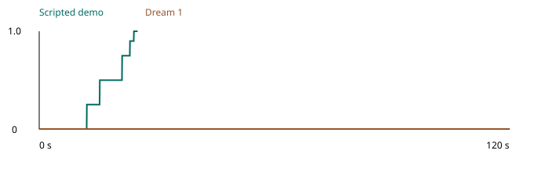

# Open a scored ampoule with a captive opener

The scripted demo scored 1.0 in 502 control steps at 20 Hz. The neck broke in native physics and the cap stayed inside the tool after release.

The goal is to open an inert scored ampoule while its separated cap stays inside a protective tool. One arm steadies the body. The other covers the cap with the tool and levers the tool through a bounded arc. The open body returns to its holder. The tool returns to its rack with its mouth facing down and the cap still retained after both arms release.

## Impact on jobs

Nurses preparing an injectable medicine supplied in a scored glass ampoule must open the container before they can draw up the prescribed dose. This benchmark isolates that manual step. One hand steadies the narrow body while the other uses the opener as a lever. The sleeve captures the detached tip so the operator can set the tool down without grasping the broken end. The score measures whether the robot can leave the body upright and the tip contained after releasing both hands. The inert replica models the handling step only. [Nursing study of ampoule opening movements](https://www.jstage.jst.go.jp/article/jbse/advpub/0/advpub_19-00037/_article/-char/en) · [Nursing study of protective opener design](https://ijosi.org/journal/IJOSI/5/2/10.6977/IJoSI.201809_5%282%29.0006)

## Source and scope

The [manufacturer use guide](https://www.qlicksmart.com/wp-content/uploads/2023/01/SNIN070215A9_SnapIT_A4_How-to-Use.pdf) shows covering the ampoule lid and breaking it while the lid stays captured. Its [product explanation](https://www.qlicksmart.com/how-to-use-guide/how-to-use-snapit-ampoule-opener/) explains why the tool retains that remnant. These sources motivate the physical operation. Their artwork and branding are not copied.

The authored tool is an original inert training replica. Four passive radial jaws approximate the compliance of a retaining ring. This is not an exact model of a commercial opener. Its 24 mm exterior and 83 mm height and 20 g mass are in the range of the plastic opener listed in the [manufacturer product dimension sheet](https://www.qlicksmart.com/wp-content/uploads/2022/12/Qlicksmart-Products-Packaging-Dimensions.pdf). That sheet includes packaging dimensions and is not a dimensioned engineering drawing. The internal geometry is the fully specified original geometry in this folder.

The cap and body are separate rigid bodies. The neck is a native fixed joint with a nominal torque break threshold. It is authored before physics starts. PhysX must produce separation through its constraint solver. No controller or scorer disables the joint or changes an object pose. The [OpenUSD joint schema](https://openusd.org/dev/api/usd_physics_page_front.html) documents native irreversible joint breaking separately from explicit joint disabling.

The 0.020 N m neck threshold is an uncalibrated prototype parameter. A corresponding inert breakaway replica must be measured before using the simulation to predict a particular physical connector. Real glass fragmentation and fluids and sterility are outside the model. A body angle constraint is a handling limit rather than a claim that no liquid was spilled.

## Setup

Use the official bimanual YAM station. Table height is 0.7475 m. Coordinates are metres. x points away from the arm bases. y points toward the left arm. z points up. Scene inventory gives every solid and joint anchor.

The light blue ampoule body has a 12 mm maximum diameter and is 40 mm long. Its neck is 6 mm across. Mass is 8 g. Its root starts at x 0.260 and y 0.020 and z 24 mm above the table. The cap is 20 mm long and at most 9 mm across with mass 1 g. Its root is at the neck plane 44 mm above the table. There is a 0.20 mm clearance between the shoulder mesh and cap base. A fixed neck joint has a nominal break torque of 0.020 N m and a nominal axial break force of 20 N. These are model parameters rather than score thresholds.

Use inert blunt polymer replicas for a physical trial. No drug or patient or sharp fragment is required. The breakaway connector and its replacement procedure require calibration to the specified break behavior. A real unprotected glass trial is not part of this task.

The blue opener is an 83 mm high rigid plastic housing with a 24 mm square exterior and a 12 mm square inner cavity. Its root starts at x 0.280 and y negative 0.140 and z 84 mm above the table. Its mouth faces down. The four jaw sliders sit at x or y plus or minus 5.2 mm and z negative 27 mm relative to the root. Each jaw is 2 mm thick radially and 4 mm wide and 6 mm high. Each has 1 g mass and a 3 mm outward stroke. Spring rate is 5000 N per metre. Damping is 5 N seconds per metre. Spring force is limited to 5 N. Root mass is 16 g. Total tool mass is 20 g. Contact offsets are 0.10 mm. The model currently uses the environment material defaults. Its ability to retain a cap through native contact must be checked on the GPU.

The ampoule body and cap and opener articulation use 128 position solver iterations and 16 velocity solver iterations. The fixed demo pauses above the cap and lowers its last insertion segment slowly. The contact monitor records maximum neck anchor separation and relative rotation before the native break event plus the duration of any 0.50 mm guard exceedance. These diagnostics measure numerical constraint convergence and do not replace the physical break event or relax containment.

The fixed body holder has a 4 mm floor and 8 mm walls around a 13 mm opening. The outer wall width is 20 mm. The floor extends 36 mm square. A separate fixed rack has a 70 mm square base. Two support ledges hold the opener 45 mm above the table so its downward mouth is clear of the floor. The exact primitive locations in the generated scene inventory take precedence over nominal overall bounds.

## Scoring

All progress is based on measured state. Robot commands and script phases are not evidence of completion. Native contacts are polled each physics step. Contact forces are ignored by the scorer.

| Score | Measured condition |
|---|---|
| 0 | Untouched start or no qualifying progress |
| 0.25 | Cap remains inside the protective cavity before it separates |
| 0.5 | Cap base is at least 12 mm from the body neck and remains captured but the objects are not returned |
| 0.75 | Body is upright in its holder and the opener is back on its rack before complete release |
| 0.9 | Both hands are open and clear and both objects are resting during the one second qualification interval |
| 1 | Complete safe release has held continuously for one second |

Any direct robot contact with the cap or within 6 mm of the body neck gives permanent zero. Close native contact means separation at most 0.20 mm. Any body tilt above 15 degrees gives permanent zero. A cap outside the tool from the first native joint break event gives permanent zero. A 0.50 mm neck separation guard also activates that constraint if event delivery is delayed. This is independent of the 12 mm progress clearance. Native transforms and cap coverage are checked each physics step so an escape followed by recovery cannot qualify. Dropping the ampoule or tool more than 2 mm below the tabletop gives permanent zero. Invalid transforms or an unavailable contact monitor fail closed.

For cap retention its base must be within 1.5 mm of the opener axis and between 33 mm and 41 mm below the tool root. All cap mesh vertices must be inside the 12 mm square cavity and between 39 mm below and 40 mm above the root. These conditions prevent a nearby exposed cap from qualifying as safely retained.

The returned body root must be within 2 mm on every axis of its original pose and within 5 degrees of upright. The returned opener root must be within 3 mm on every axis of its rack pose and within 5 degrees of upright. Rest is measured directly from native physics substeps. Over a continuous one second every vertex of the body and cap and opener housing and four movable jaws must have peak excursion at most 0.50 mm and each rigid body orientation must change by at most 1 degree. The diagonal of each vertex trajectory bounding box provides a conservative bound on every pairwise displacement. Any excursion or loss of hand clearance or opening or return pose restarts the complete interval. Both hands must remain open and clear throughout. After this measured interval the scorer requires another continuous one second of these conditions before full score. This observable criterion replaces raw instantaneous velocity thresholds because a prior native trial reported cap transverse spin above 5 radians per second while its measured final second pose moved less than 60 nanometres. Every native substep is checked to exclude 20 Hz aliasing. Both finger joints on both arms must exceed 35 mm open travel and the native contact monitor must report no robot contact with a movable object. The simulator also requires its normal one second success hold after the scorer reaches 1.

For the inert physical replica use a ruler and a side photograph and an angle gauge to establish separation and support and protection. Use the recorded video to check direct contact constraints. The housing hides the cap in the overhead view. For a physical trial place a mirror below the open mouth or record that view through the gap in the rack. In simulation the retained cap position comes from the native trajectory. No sensitive force sensor is needed to score a trial. A force or torque measurement used when commissioning a breakaway connector is a calibration step and is not a trial score.

## Local checks

The validator uses only NumPy and the official pure Python YAM kinematics. It checks the scorer against unsafe direct contact and uncaptured separation and cap escape and delayed release and interrupted dwell. It also checks geometry and source structure and the full fixed waypoint trajectory against actual robot joint limits.

```bash
PYTHONPATH=/path/to/yam-isaac-lab-arena python validate.py
```

Its report is `cpu_validation.json`. A CPU pass does not establish native collision correctness or native fracture correctness or full score feasibility.

## Run a trial

From this task directory on the YAM launchable run the following commands.

```bash
source /data/IsaacLab-Arena/yam.env
uv pip install --python /data/IsaacLab-Arena/.venv/bin/python --no-deps -e runtime -e policy
export OPENBLAS_NUM_THREADS=1 OMP_NUM_THREADS=2 MKL_NUM_THREADS=1 YAM_LIMIT_CPU_THREADS=8
mkdir -p runs/pilot
export YAM_TELEMETRY="$PWD/runs/pilot/telemetry.jsonl"
inspect-robots run --embodiment ampoule_yam --policy yam_scripted \
  -E task="$PWD/task.py" -E object_jitter=0 -E control_hz=20 \
  -E cam_width=1280 -E cam_height=720 --seed 0 --epochs 1 \
  --instruction "Open the inert scored ampoule using the captive opener. Keep the ampoule body upright. Keep both grippers off the cap and neck. Leave the open body in its holder and the cap retained inside the opener on its rack. Release both hands." \
  --scorer task_score --max-steps 200 --store-frames --log-dir runs/pilot
```

For the full demo use the same command with `--max-steps 2400` and a fresh log directory. For the model use a new process and the same scene, instruction, seed, frame size and limit. Replace `--policy yam_scripted` with `--policy dream_current -P server_url=http://127.0.0.1:8241 -P rows_per_request=8`. In another shell with the Dream SDK and credentials configured run `DREAM_BRIDGE_PORT=8241 python policy/current_api_bridge.py`. Use a separate telemetry path and log directory for each trial. The no break control uses the same native scene and the actions in `counterexample_no_break.py`.

Render the three native camera views with `inspect-robots video LOG.json`. Each view is 1280 by 720 pixels at 20 Hz.

## Reset and license

The fixed neck is consumed by a trial. Run one epoch per process so a new joint is authored before simulation initialization. Return the body and cap and opener to the listed poses. Return all four jaws to their inward stops. Use seed 0 and object jitter 0 for the fixed layout. Resetting a broken native joint inside an existing simulator process is not supported by this prototype.

The original task code and original primitive geometry are provided under `LICENSE.txt`. No manufacturer logos or artwork or third party meshes are included. The bundled extension adds passive articulated props to the native YAM station. Official YAM and Isaac Lab Arena and Inspect Robots keep their own upstream licenses.


The observable rest controls can be reproduced with python validate_observed_rest.py. They reject native substep translation and rotation oscillation and drift. They require a new complete interval after loss of clearance or a late excursion. Invalid 20 Hz samples are rejected rather than interpolated.

A measured neck gap alone can earn at most 0.25 while the cap remains covered. Every grade above 0.25 requires a confirmed native joint break. Dream 1 left the ampoule unopened. The run recorded no direct cap or rim contact and no cap escape.

## Recorded evaluations

Dream 1 scored 0.0 in 2400 steps. The scripted demonstration scored 1.0 in 502 steps. The demo took 341.8 seconds of wall time and the model took 881.1 seconds. Both trials ran at 20 Hz. The model had 0 session recoveries.



In a separate 400 step control the robot covered the cap and held the opener without commanding a levering or extraction motion. The native neck joint broke at 15.65 seconds. The maximum measured separation was 2.05 mm. The cap stayed covered and the control scored 0.25. Opening credit requires at least 12 mm of separation after a confirmed break. A break event alone does not establish extraction or successful tool use.
