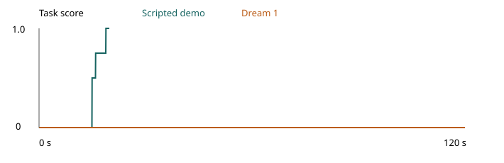

# Support a bound volume for digitization

The scripted YAM demonstration reached 1.0 in 396 control steps at 20 Hz (19.8 seconds of simulated time).

## Why this operation matters

Archives digitize bound records that cannot safely be flattened. The operator must open a useful spread while maintaining support under the two textblocks. This task tests that physical support transition on a full size inert volume. Lifting a closed book or setting an empty reading stand does not meet the objective.

The [Canadian Conservation Institute guide](https://www.canada.ca/en/conservation-institute/services/conservation-preservation-publications/canadian-conservation-institute-notes/display-methods-books.html) explains why book supports should accommodate the binding and chosen opening. The [NARA camera operator guidelines](https://www.archives.gov/exhibits/ija/sites/default/files/page-images/content/1.0/1.2%20Conservation%20Guidelines%20for%20Camera%20Operators.pdf) describe conservator reviewed handling during bound record imaging. These sources motivate support and opening constraints. They do not prescribe this task's nominal dimensions or its 115 degree limit. That limit belongs only to the inert test specimen.

The simulated volume is a two textblock approximation of an already selected spread. It is not a model of individual pages or binding damage. Success means compliance with the declared opening and support conditions. It does not certify conservation safety for an actual archival item.

## Instruction

Move the inert volume from the narrow transport cradle to the wide imaging cradle. Open it to the marked 110 degree spread. Support both textblocks on their cradle surfaces and leave the binding channel clear. Never open beyond 115 degrees. Release both hands and leave the volume still. Do not turn individual pages.

## Objects and fixed layout

Use the official bimanual YAM station. The table is z 0.7475 m. The origin is midway between the arm bases. x points away from the arms and y points toward the left arm. All nominal coordinates are metres. Use seed 0 and zero object jitter.

The bound volume is 240 mm along its spine. Each textblock extends 180 mm from its spine hinge and is 14 mm thick. Each half has mass 275 g. A 50 g spine joins the two halves for a total of 600 g. A physical inert specimen uses rigid paper faced boards and ballast with two unpowered pin hinges along x. It has no sharp edges or fragile historical material. The paper faces are represented by rigid contact solids. Each hinge has low damping and can move through a full 180 degree half plane. It has no hard stop at the scored 115 degree opening limit.

The spine is 240 by 14 by 32 mm. Its initial centre is (0.100 0 0.7775). Its orientation is identity. The two hinge lines are at local y +7 mm and negative 7 mm. The positive y leaf begins at a 60 degree rotation about +x and the negative y leaf at 120 degrees. Their included opening is 60 degrees. These angles are measured from the positive y horizontal ray. They are not individual hinge commands sent by the policy.

Two fixed inert transport supports are centred at x 0.100. Their inclined faces coincide with the outer bearing faces of the two initial leaves. Each source support has two 90 mm wide strips along x at local x negative 75 mm and +75 mm. A 60 mm central access gap lets the lower gripper finger reach under the bare textblock fore edge. Four fixed imaging supports are centred at x 0.360. They use the same strip widths and central access gaps. Their upper faces coincide with the desired leaf outer faces at 35 and 145 degrees. The imaging spread therefore has a 110 degree opening. The spine centre is (0.360 0 0.7775) at the target. The binding channel is more than 20 mm wide and the 14 mm spine remains above the table. There is no support directly under the binding.

The cradle solids represent rigid acrylic backing faced with inert polyethylene foam. Foam compression is omitted. Contact material uses the official simulator defaults. Neither cradle may move. Each is bolted to the same table in a physical test. No clamps hold the volume and no extra grasp handles are present. The arms grasp the bare textblock fore edges approximately 10 mm in from their ends. The scene contains no other task objects. `scene_inventory.json` lists every collider vertex and joint frame.

## Score and simple tools

Measure leaf angles with a protractor. A ruler and photograph establish the spine position and orientation. Use a 0.20 mm feeler blade at the front and back bearing strips under each textblock. Each of those four independent support checks must prevent the blade passing through without lifting the textblock. The simulator uses native contact separation at that same threshold. It does not use force thresholds.

Any opening beyond 115 degrees at any observed control step makes the trial score zero permanently. Dropping any volume solid more than 8 mm below the tabletop or a nonfinite state also makes the trial score zero. A failed contact monitor raises an evaluation error rather than claiming success. All conditions are sampled at 20 Hz.

All nonzero scores require the target spine position within 5 mm Euclidean distance and spine tilt within 3 degrees and yaw within 5 degrees. Each leaf must be within 3 degrees of its required angle in the fixed imaging cradle frame. The included opening is measured between the leaves. The opening must lie between 104 and 115 degrees.

* 0.25: at least one of the four bearing strips supports the aligned spread.
* 0.5: at least one bearing strip under each textblock supports it.
* 0.75: all four bearing strips support it.
* 1.0: all four bearing strips support it with both arms released and the volume at rest for a continuous second.

Released means each measured finger joint is open beyond 35 mm and no native robot contact is within 1 mm of any volume body. At rest means every volume body moves no faster than 8 mm per second and rotates no faster than 0.1 radian per second. Losing any full score condition resets the one second timer. The initial narrow spread and a generic lift both score zero. All other outcomes score zero.

## Runtime and commands

Install the task's runtime and policy extensions into the official Isaac Lab Arena YAM environment. Run only one epoch per process. Do not launch Dream until the short scripted pilot and the scorer counterexamples are inspected.

```bash
source /data/IsaacLab-Arena/yam.env
uv pip install --python /data/IsaacLab-Arena/.venv/bin/python --no-deps -e runtime -e policy
export OPENBLAS_NUM_THREADS=1 OMP_NUM_THREADS=2 MKL_NUM_THREADS=1 YAM_LIMIT_CPU_THREADS=8
python validate.py --ik
inspect-robots run --embodiment yam_articulated --policy yam_scripted \
  -E task="$PWD/task.py" -E object_jitter=0 -E control_hz=20 \
  -E cam_width=1280 -E cam_height=720 --seed 0 --epochs 1 \
  --instruction "Move the inert volume from the narrow transport cradle to the wide imaging cradle. Open it to the marked 110 degree spread. Support both textblocks on their cradle surfaces and leave the binding channel clear. Never open beyond 115 degrees. Release both hands and leave the volume still. Do not turn individual pages." \
  --scorer task_score --max-steps 200 --store-frames --log-dir runs/pilot
```

The fixed demonstration is 22 seconds of control time. The 200 step pilot intentionally stops before the complete demonstration. After inspecting that pilot run the same command with `--max-steps 2400` and `--log-dir runs/demo`. The trial should end only when the native full score conditions hold.

For the model use the supplied Dream bridge in a separate environment with `dreamlabs==1.0.37` and `dreamlabs-client==1.1.3`. Keep its credentials outside this folder. Start `policy/current_api_bridge.py` with `DREAM_BRIDGE_PORT=8241 JAX_PLATFORMS=cpu`. Replace the demo policy with `--policy dream_current -P server_url=http://127.0.0.1:8241 -P rows_per_request=8` and use `--max-steps 2400 --log-dir runs/model`. Preserve a complete successful evaluation receipt even if its score is zero. An errored provider attempt is not a completed zero score trial.

Render receipts with `inspect-robots video LOG.json`. The setup image must be the native initial frame. The model and full score demo must each use the final identical source. Export all three cameras as H264 MP4 at native 1280 by 720 and 20 frames per second. Upload only after reviewing the whole run and checking source hashes and frame counts.

## Counterexamples and reset

Run `overopen_attempt.py` using the same scripted command to test a deliberately flattened spread. It must receive zero once it exceeds 115 degrees. `hover_attempt.py` keeps the spread held 3 mm above its support faces. It must not earn full score. Those are native action plans and do not edit simulated object states. CPU checks independently remove each support reading and test release and rest and timing and nonfinite states. They do not replace the native counterexample runs.

Reset the volume to the source support with the 60 degree opening and the spine at its specified pose. Restore both passive hinge positions and zero their velocities. Restore the fixed cradle poses. Nothing is consumed. Do not use a historical book in a hardware feasibility trial.

## Fidelity and current limitations

The book is represented by three rigid bodies and two passive hinges. Gravity and rigid contacts carry the volume. This approximation preserves the selected spread's opening and support geometry but omits paper compliance and hinge translation and binding material strain. No rupture or permanent damage is simulated. The scorer's permanent opening violation is an explicit handling limit rather than a damage model. The one second hold is part of the scorer.

The full orientation demo uses precomputed waypoints and official robot kinematics. It reads no simulator object state and has no privileged correction. The recorded demonstration used both bare fore edges.

All original task geometry and code are released under MIT in `LICENSE.txt`. The runtime extends the official YAM environment. No third party mesh or source illustration is distributed.

Independent spine clearance is scored separately from the four textblock supports. A native contact view checks the spine against every imaging cradle solid at 0.20 mm separation. Its actual lowest corner must also remain more than 1 mm above the tabletop for any credit. Missing or nonfinite contact data errors the trial. The full score requires both clearance checks throughout the final one second hold.

## Recorded trials

Dream 1 scored 0.0 in 2400 steps. The scripted demo scored 1.0 in 396 steps. Both ran at 20 Hz. The scripted run took 164.2 seconds of wall time. The model run took 640.2 seconds of wall time with 0 provider session recoveries. The policy requested new actions after executing up to 8 steps. The commanded flattening attempt reached 110.12 degrees and finished with its spine 13.28 mm from the target. It scored 0.0. The held spread contacted 2 bearing strips and scored 0.5. A separate in-air opening control exceeded 115 degrees at 15.00 seconds and peaked at 115.105 degrees. Every subsequent sample scored zero. Run it with the same scripted command using the controls/book_open_in_air.py task path and include the task folder in PYTHONPATH.


