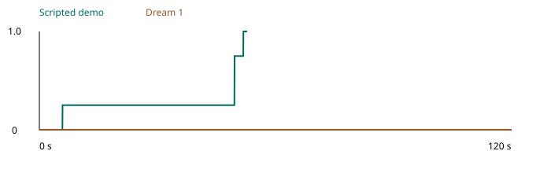

# Square a milling vise with an indicator

Square the fixed jaw of the swivel vise to the indicator traverse. Secure the base and repeat the sweep. A crooked jaw changes the orientation of work located against it during milling. Aligning workholding fixtures is a documented machinist duty. The setup runs on an unpowered bench. [Machinist duties](https://www.onetonline.org/link/summary/51-4041.00) and [manufacturer setup instructions](https://sherline.com/wp-content/uploads/2015/12/3570inst.pdf).

The vise base and indicator rail are fixed at (0.250, 0, 0.7475) m in station coordinates. The steel fixed jaw is 80 mm wide. Its starting yaw is 4 degrees. The indicator carriage starts 35 mm to one side of centre. The steel probe bears on the fixed jaw. The indicator hand shows the measured probe travel. The other hand can adjust the jaw while an eccentric cam compresses a spring loaded friction shoe against the swivel. The native rotor and jaw turn as one part. The vise screw carries a vertical 44 mm by 6 mm steel tommy bar with a 12 mm diameter stop at its upper end. The left hand can grip that stop to swing the loosened vise. All solid dimensions and joint anchors are in scene_inventory.json and design.py.

Use a dial indicator on the physical bench. Sweep the probe in contact through the centre and both 30 mm end regions. Reject readings at either travel stop. An aligned sweep spans at most 0.20 mm. Check the visible pad witness and watch the swivel throughout the last sweep. The full score also requires the adjustment hand clear during that sweep and both hands clear after it. The full scoring implementation is in scoring.py. The fixture models rigid parts. It does not simulate a powered spindle or cutting loads.

Use seed 0 and zero object jitter. Restore the documented swivel angle and closed cam and the indicator carriage start for every trial. Run one epoch per process. A full trial permits 2400 control steps at 20 Hz. 


## Machining setup

At the initial four degree error a 60 mm sweep across a straight jaw produces about 4.2 mm of dial variation. A part located against that jaw inherits the angular error. Robotic fixture setup therefore requires the ability to adjust the workholding device and verify the result after tightening it. The published limit of 0.20 mm is the benchmark tolerance for this bench fixture.

US employment in 2025 was 288 300 machinists plus 170 000 CNC tool operators and 127 100 multiple machine tool setters and operators. O*NET identifies alignment of holding fixtures or workholding devices as part of each occupation. The combined 585 400 jobs describe occupations where fixture alignment occurs. The survey does not count individuals who perform this exact milling vise operation. [BLS machinists](https://www.bls.gov/ooh/production/machinists-and-tool-and-die-makers.htm) and [BLS machine workers](https://www.bls.gov/ooh/production/metal-and-plastic-machine-workers.htm). [Machinist tasks](https://www.onetonline.org/link/summary/51-4041.00) and [CNC operator tasks](https://www.onetonline.org/link/summary/51-9161.00) and [multiple machine tool setter tasks](https://www.onetonline.org/link/summary/51-4081.00).

## Reproduce a trial

From this task directory on the YAM launchable run the following commands. Set the working directory independently for each trial so the recordings and telemetry stay together.

```bash
source /data/IsaacLab-Arena/yam.env
uv pip install --python /data/IsaacLab-Arena/.venv/bin/python --no-deps -e runtime -e policy
export PYTHONPATH="$PWD/runtime:$PWD/policy:$PWD:$PYTHONPATH"
export OPENBLAS_NUM_THREADS=1 OMP_NUM_THREADS=1 MKL_NUM_THREADS=1 YAM_LIMIT_CPU_THREADS=8
mkdir -p runs/demo
export YAM_TELEMETRY="$PWD/runs/demo/trajectory.jsonl"
inspect-robots run --embodiment yam_articulated --policy yam_scripted \
  -E "task=$PWD/task.py" -E object_jitter=0 -E control_hz=20 \
  -E cam_width=1280 -E cam_height=720 --seed 0 --epochs 1 \
  --instruction "Square the vise fixed jaw to the traverse axis and secure the base. Confirm its alignment with the indicator. Leave both grippers clear. All machinery is unpowered." \
  --scorer task_score --max-steps 2400 --store-frames --log-dir runs/demo
```

For Dream 1 set up its authenticated SDK bridge in a separate shell with `DREAM_BRIDGE_PORT=8241 python policy/current_api_bridge.py`. Run the same scene and instruction in a fresh process. Use a fresh log and telemetry directory and replace `--policy yam_scripted` with `--policy dream_current -P server_url=http://127.0.0.1:8241 -P rows_per_request=8`. The trial envelope is 120 simulated seconds. Render all three cameras with `inspect-robots video LOG.json --out rendered`.
## Recorded evaluations

Dream 1 scored 0.0 in 2400 steps. The scripted demonstration scored 1.0 in 1056 steps. The demo took 380.1 seconds of wall time and the model took 781.3 seconds. Both trials ran at 20 Hz. The model had 0 session recoveries.


